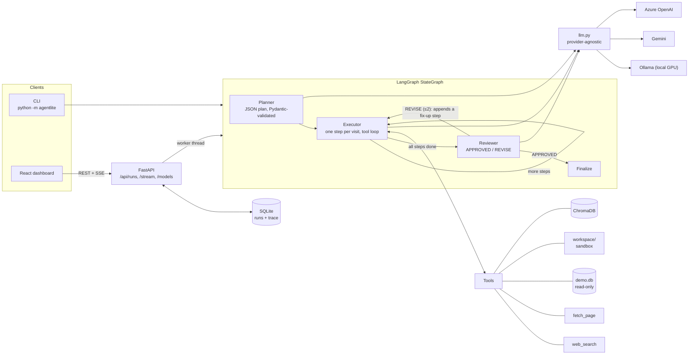
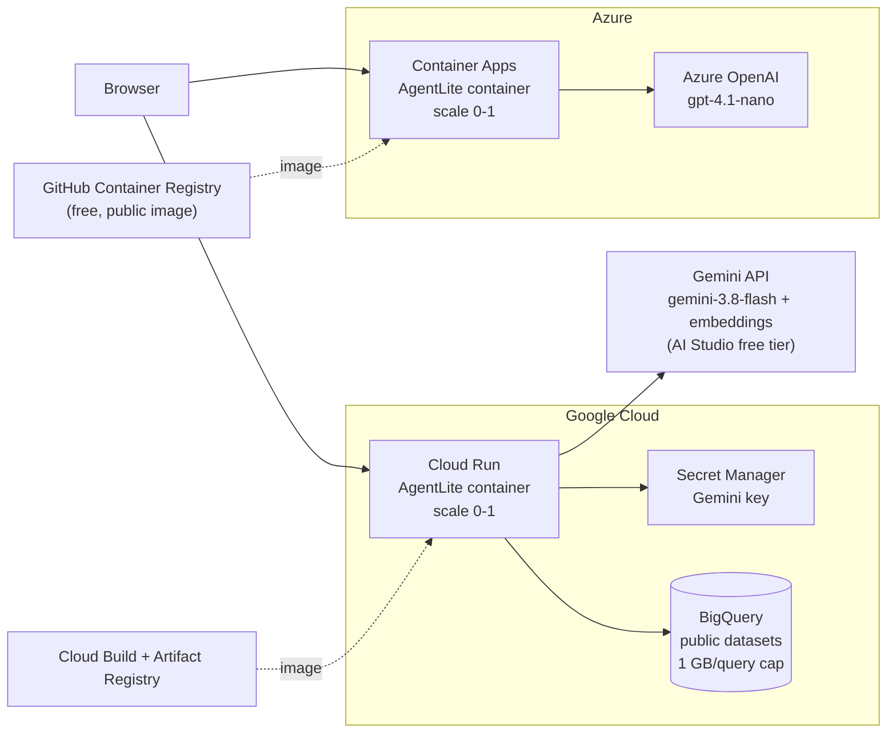

# AgentLite

**Multi-agent task automation that runs on small, local LLMs** (3B–7B models on a 4 GB GTX 1650), with optional
Gemini and Azure OpenAI providers. A planner, an executor and a reviewer work together over a LangGraph state
machine, use real tools (web search, web pages, SQL, files, RAG over your documents), and return the answer with a
full step-by-step trace. A benchmark harness measures how well each model actually does.

Flagship demo: **Job Research Agent**. Give it a job posting (URL or text) and your resume. It researches the
company, extracts the requirements, compares them with your resume (matching skills and gaps), and drafts interview
talking points and a short cover letter. It never submits applications: no tool can submit a form.

| | |
|---|---|
| Agents | LangGraph `StateGraph`: Planner → Executor (one step at a time, with tools) → Reviewer (APPROVED / REVISE, max 2 retries) |
| Models | Ollama (`qwen2.5:3b` default, `qwen2.5:7b`, `llama3.2:3b`, `qwen3:4b`), Gemini, Azure OpenAI: chosen in config |
| Tools | `web_search` (DuckDuckGo), `fetch_page`, `sql_query` (read-only SQLite), `read_file` / `write_file` / `list_files` (sandboxed), `knowledge_search` (ChromaDB RAG), `bigquery_query` (optional) |
| App | FastAPI (SSE streaming, SQLite run history) + React/Vite/TypeScript/Tailwind dashboard |
| Quality | 18-task benchmark with exact/keyword/file/LLM-judge checks, failure analysis; 50+ pytest tests |

---

## Architecture



**Shared state** (`agentlite/state.py`): `task, plan, current_step, step_results, review, final_answer, trace, retries`.
Every node appends a trace entry with agent, input, output, tool calls (args, output, latency, error),
provider, model, token counts and latency in ms.

**Routing rule**: after the executor *and* after the reviewer, the graph asks one question: *is there a plan step that
hasn't run yet?* The reviewer asks for a revision by appending a step (“rewrite the answer, fixing X”), so revision
reuses the normal executor path. There are no extra flags, and a 3B model doesn't have to redo the whole plan.

---

## Quick start (Windows, PowerShell)

```powershell
# 1. Ollama (native, uses your GPU)
winget install Ollama.Ollama
ollama pull qwen2.5:3b
ollama pull nomic-embed-text          # embeddings for RAG
ollama pull qwen2.5:7b                # optional: better quality, slower (judge model for evals)
ollama pull llama3.2:3b               # optional

# 2. Python 3.11+
python -m venv .venv
.\.venv\Scripts\Activate.ps1
pip install -r requirements-dev.txt
Copy-Item .env.example .env           # works as-is; no keys needed

# 3. Try it
python -m agentlite "Which product category had the highest total revenue in the sales database?"
python -m agentlite --list-models

# 4. Job Research (put your own resume in docs/; it's git-ignored)
python -m agentlite.ingest
python -m agentlite --job-file examples/sample_job_posting.txt --resume docs/sample_resume.md
python -m agentlite --job-url https://company.com/careers/123 --resume docs/my_resume.pdf

# 5. Dashboard
cd frontend; npm install; npm run build; cd ..
uvicorn api.main:app --port 8080       # open http://localhost:8080
# (dev mode with hot reload: run uvicorn, then `npm run dev` in frontend/ and open :5173)
```

### Docker (app only; Ollama stays native for GPU access)

```powershell
docker compose up --build             # http://localhost:8080, talks to Ollama via host.docker.internal
```

If the container can't reach Ollama, run `setx OLLAMA_HOST 0.0.0.0` and restart the Ollama app.

### API

| Method | Path | |
|---|---|---|
| `POST` | `/api/runs` | `{mode: "general", task, provider?, model?}` or `{mode: "job", job_posting_url \| job_posting_text, resume_text?}` → `{run_id}` |
| `GET` | `/api/runs/{id}` | status, plan, final answer, full trace |
| `GET` | `/api/runs/{id}/stream` | Server-Sent Events: one `trace` event per agent step, then `done` |
| `GET` | `/api/runs` | run history |
| `GET` | `/api/models` | models per enabled provider |
| `POST` | `/api/ingest` | re-index `./docs` |
| `POST` | `/api/uploads/resume` | extract text from a PDF/MD/TXT resume |
| `GET` | `/api/evals/latest` | latest benchmark report |

Interactive docs at `/docs`. All routes are under `/api` so the same server can host the React app at `/`.

---

## Evaluation

```powershell
python -m evals.run_evals                                    # qwen2.5:3b vs qwen2.5:7b vs llama3.2:3b
python -m evals.run_evals --models ollama/qwen2.5:3b --tasks sql_top_seller job_gap_accuracy
```

`evals/tasks.yaml` has 18 tasks across SQL, files, web search, reasoning, RAG, Job Research and safety. Each task
has one check:

- **exact**: a ground-truth value must appear (the SQL answers come from a seeded, deterministic database)
- **contains**: required keywords, with accepted alternate spellings
- **file**: the agent must actually write the file, with the right content
- **judge**: LLM-as-judge (`qwen2.5:7b`) with a task-specific rubric

The harness runs in a sandbox (its own workspace, DB and vector index built only from the sample resume), runs
all tasks per model before grading (so Ollama doesn't swap model weights between tasks), and writes
`evals/results/latest.json` (shown on the dashboard's Evals page), `latest.md`, and a timestamped CSV.

### Results: local models (GTX 1650 4 GB, 16 GB RAM)

_Results pending._ The first full run was stopped when the PC ran out of RAM while loading `qwen2.5:7b`
(about half of its ~4.7 GB spills from the 4 GB GPU into system memory). To reproduce, run one model at a time
with other apps closed:

```powershell
python -m evals.run_evals --models ollama/qwen2.5:3b --judge ollama/qwen2.5:3b
```

The table, per-category scores and failure analysis are written to `evals/results/latest.md`.

---

## Design decisions

**Why small local models?** They cost nothing per token, keep documents like a resume on your machine, and
they make agent-design problems visible. A 3B model misformats JSON, calls tools with the wrong arguments, and
forgets context, so the system has to handle that. Everything that makes AgentLite work on a 3B model (validated
outputs, corrective retries, short focused prompts, fixed plans where reliability matters) makes it more reliable on
large models too.

**Why LangGraph?** The workflow is a loop with a conditional edge (reviewer → executor), not a straight chain.
LangGraph makes the state explicit (a `TypedDict` with a reducer for the trace), makes routing plain Python
functions that are easy to unit test (`route_after_executor`, `route_after_reviewer`), and streams per-node updates,
which the API turns directly into SSE events.

**Handling small-model failures** (all of them are recorded in the trace, none crash the run):

| Failure | Handling |
|---|---|
| Planner returns invalid JSON | Pydantic validation → one retry with the exact error → fall back to a one-step plan |
| Tool call written as text instead of a real tool call | Parsed and executed anyway |
| Wrong tool name / bad arguments | Error plus the correct argument schema fed back as the tool result |
| Tool keeps failing | Stop after 3 consecutive errors with a clear message |
| Reviewer returns invalid JSON | Retry → keyword fallback (`APPROVED`/`REVISE`) → accept rather than loop |
| Reviewer never satisfied | Stop after 2 revisions; answer is returned with a note |
| `<think>` blocks (qwen3) | Stripped from answers |

**Fixed plan for Job Research.** The flow always needs the same four steps, and a 3B planner sometimes merges or
skips them. Passing a predefined plan skips only the planner; the executor, tools and reviewer run exactly as in
general mode.

**Context budget.** `num_ctx` is capped at 8192 in code because a larger context pushes the KV cache out of 4 GB of
VRAM. To fit: tool outputs are truncated (web snippets 300 chars, pages 6,000, SQL 50 rows), each executor step only
sees truncated results of earlier steps, and Job Research inputs are staged as workspace files the executor reads
when needed instead of being pasted into every prompt.

**Hardware constraints.** `qwen2.5:3b` (~2 GB) fits entirely in VRAM. `qwen2.5:7b` (~4.7 GB) partially runs on the
CPU, which is why it's slower. The API runs one graph at a time by default (`RUN_WORKERS=1`): two concurrent runs on
one 4 GB GPU only slow each other down. Runs queue instead.

**Safety by construction.**
- `sql_query` is read-only three ways: it only accepts SELECT, opens the DB in read-only mode, and installs a SQLite authorizer that denies writes.
- File tools resolve every path and refuse anything outside `./workspace` (blocks `..`, absolute paths, symlinks).
- `fetch_page` only does GETs, and refuses private, loopback and link-local addresses, including after redirects. That blocks SSRF to cloud metadata endpoints once the app is deployed.
- No tool can submit forms, so applying to a job is impossible.
- `bigquery_query` sets `maximum_bytes_billed` and does a dry run first.

**Storage and streaming.** Each trace entry is written to SQLite as soon as its node finishes, and the SSE endpoint
streams rows by sequence number. Any number of tabs can watch the same run, reconnecting browsers resume with
`Last-Event-ID`, and history survives restarts. The tradeoff is a 0.5 s polling delay instead of push.

**One container.** FastAPI serves the built React app, so local Docker, Cloud Run and Azure Container Apps all run
the same single service on one port, without CORS or a reverse proxy.

**Tradeoffs and limitations.**
- Small models still make factual mistakes the reviewer misses. The reviewer is the same small model, so it shares the executor's blind spots. The benchmark measures this rather than hiding it.
- The LLM judge (`qwen2.5:7b`) is also a small model. Rubrics are kept narrow, and judging is one of four check types, not the only one.
- Web results change over time, so web-task scores can drift between runs. SQL, file and RAG tasks are deterministic.
- On Cloud Run, run history lives in the container and is lost when it scales to zero. A real deployment would use Cloud SQL or Firestore.

---

## Cloud (optional)

Both deployments use the same Docker image. The cloud has no GPU for Ollama, so they use hosted models.



- **Gemini**: set `GOOGLE_API_KEY` (create it in a Google Cloud project **without billing**, so it can only use the free tier).
- **Azure OpenAI**: set the `AZURE_OPENAI_*` variables. Pay per token, no free tier, but fractions of a cent per run with `gpt-4.1-nano`.
- **BigQuery**: set `GOOGLE_CLOUD_PROJECT` and run `gcloud auth application-default login`. Queries are capped at 1 GB each, and the free tier is 1 TB/month.

| | Deploy | Budget alert | Teardown |
|---|---|---|---|
| GCP (Cloud Run + Gemini) | `deploy/gcp/deploy.ps1` | `deploy/gcp/budget.ps1` ($1) | `deploy/gcp/teardown.ps1` |
| Azure (Container Apps + Azure OpenAI) | `deploy/azure/deploy.ps1` | `deploy/azure/budget.ps1` ($1) | `deploy/azure/teardown.ps1` |

Each script starts with a cost notes section. Budgets only send alerts; they don't stop spending, so run the
teardown script when you're done.

---

## Tests

```powershell
pytest                                  # offline: graph routing, tools, API, eval graders, providers
$env:AGENTLITE_NETWORK_TESTS=1; pytest  # also hits the network
```

Graph and API tests use a scripted `FakeLLM`, so they run in ~3 seconds with no Ollama.

## Project structure

```
agentlite/            core library
  config.py           settings from .env
  llm.py              provider-agnostic LLM layer (Ollama, Gemini, Azure OpenAI)
  state.py            shared graph state + trace entry types
  graph.py            LangGraph wiring, routers, streaming
  agents/             planner, executor, reviewer, tool-calling loop
  tools/              one tool per file
  rag.py, ingest.py   ChromaDB index over ./docs
  jobs.py             Job Research plan
api/                  FastAPI app, run store (SQLite), background runner
frontend/             React + Vite + TypeScript + Tailwind
evals/                tasks.yaml, graders, runner, results/
tests/                pytest suite
deploy/gcp, azure/    deploy, budget and teardown scripts
docs/                 your documents for RAG (only sample_* is committed)
workspace/            the only folder agents can read/write
```
